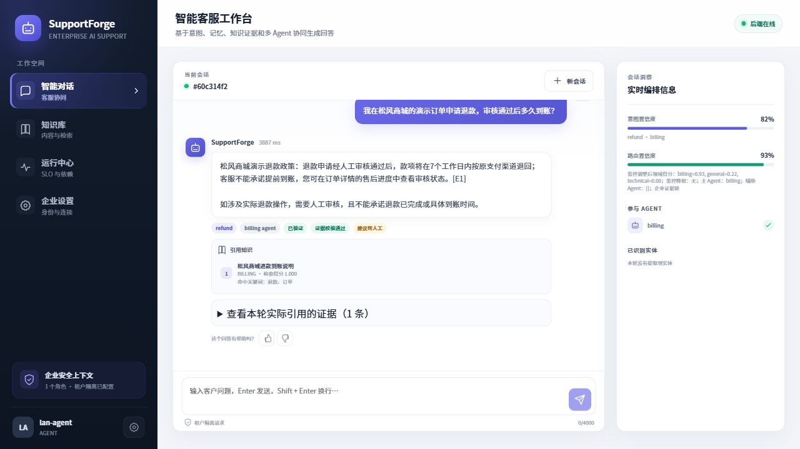
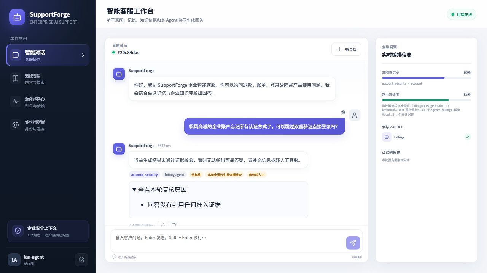

# SupportForge

[简体中文](README.zh-CN.md) · [Architecture](docs/architecture.md) · [Retrieval benchmark](docs/benchmark.md)

SupportForge is a Java 21 customer support workbench for billing, account and product questions. It routes each request to a support agent, looks up tenant-authorized knowledge, and returns an answer with citations. If the evidence is missing or the answer fails verification, the workbench asks for more information or suggests human review.

The local profile runs with mock providers. The enterprise profile connects to a chat model, an embedding service and a reranker through configurable APIs.

## Enterprise demo

Both captures are from the local enterprise deployment with live model APIs. The questions and the storefront policy were written for the demo.

**Refund policy with a citation.** The billing agent quotes the seven-business-day policy and links the exact source used for the answer.



<details>
<summary>See what happens when the answer fails verification</summary>

The second request has no admissible citation in the generated answer. SupportForge withholds that answer and shows the verification failure.



</details>

## Quick start

**Backend** · JDK 21 and the Maven Wrapper. The default profile needs no API key.

```powershell
.\mvnw.cmd spring-boot:run
```

Use `./mvnw spring-boot:run` on Linux or macOS. The API listens on `http://localhost:7000`.

```powershell
$body = @{ message = 'How do I request a refund?'; user_id = 'demo-user' } | ConvertTo-Json
Invoke-RestMethod http://localhost:7000/chat -Method Post -ContentType 'application/json' -Body $body
```

**Workbench** · With the backend running, use Node.js 22 and open the URL printed by Vite.

```powershell
cd frontend
npm ci
npm run dev
```

### Enterprise deployment

From the repository root, copy [the environment template](.env.example) to `.env`. Set the model, endpoint and key for each provider in the `SUPPORTFORGE_LLM_*`, `SUPPORTFORGE_EMBEDDING_*` and `SUPPORTFORGE_RERANKER_*` groups. Use `openai-compatible` for the chat and embedding providers and `vllm` for the reranker provider. Fill in the deployment settings referenced by Compose, then run:

```powershell
.\scripts\Initialize-LanAccess.ps1
docker compose -f docker-compose.yml -f docker-compose.enterprise.yml -f docker-compose.frontend.yml up --build -d
```

Open `http://localhost:3000`. In **企业设置**, use the local agent token from `data/lan-access/tokens.json` to verify the connection. The backend readiness endpoint is `http://localhost:7000/actuator/health/readiness`. Keep `.env` and the token file local.

## Retrieval results

The C-MTEB EcomRetrieval run used 100,902 passages and 1,000 queries. With real embeddings and Qdrant, Dense-only reached **85.10% Recall@10** and **173.21 ms offline P95**. Reranking raised hybrid RRF from 76.20% to 83.80% Recall@10, with P95 increasing from 170.82 ms to 1,043.32 ms. See the [full results and reproduction steps](docs/benchmark.md).

## Verification

| Check | Command |
| --- | --- |
| Backend tests and quality gates | `./mvnw verify` or `.\mvnw.cmd verify` |
| Workbench | In `frontend`, run `npm ci`, `npm test` and `npm run build` |
| Live enterprise wiring | `.\scripts\Test-EnterpriseWiring.ps1` after the enterprise stack is running |

The enterprise wiring check imports demo data and can use paid model APIs. The [GitHub Actions workflow](.github/workflows/quality-gates.yml) also validates Compose and builds the production image.

## Repository map

| Path | Contents |
| --- | --- |
| [`src/main/java/com/supportforge`](src/main/java/com/supportforge) | Agent routing, retrieval, grounding, persistence and evaluation |
| [`frontend`](frontend) | React and TypeScript workbench |
| [`scripts`](scripts) | Provider checks, dataset import and benchmark commands |
| [`deploy`](deploy) | Kubernetes deployment templates |
