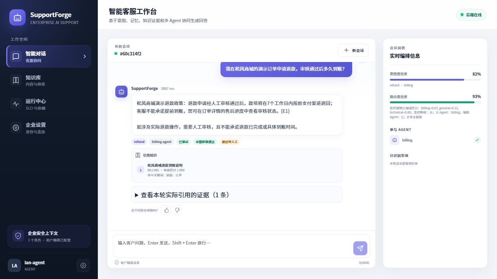
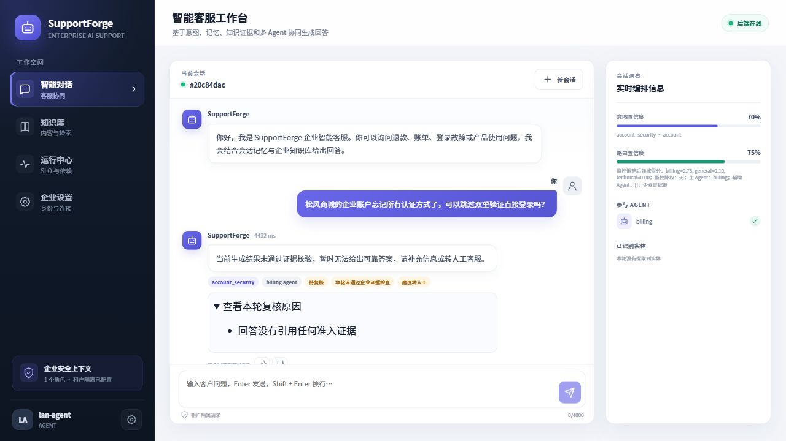

# SupportForge

[English](README.md) · [系统架构](docs/architecture.zh-CN.md) · [检索评测](docs/benchmark.zh-CN.md)

SupportForge 是一个用 Java 21 写的智能客服工作台，处理退款、账单、账号与产品使用问题。系统先把问题路由给对应的 Agent，再从当前租户可访问的知识库里找证据。回答会带上引用来源。缺少证据或回答未通过校验时，工作台会提示补充信息或建议转人工。

默认模式使用 Mock，可以离线体验。企业模式通过配置接入真实的对话模型、Embedding 和 Reranker API。

## 企业版实测

截图来自本地运行的企业版，已接入真实模型 API。问题和商城政策均为演示数据。

**退款问答。** 账单 Agent 引用了刚入库的演示政策，回答「人工审核通过后，7 个工作日内按原支付渠道退回」。



<details>
<summary>查看回答未通过校验时的界面</summary>

第二次请求的生成结果没有引用合格证据，系统拦下回答并在工作台展示复核原因。



</details>

## 快速开始

**后端**需要 JDK 21 和仓库自带的 Maven Wrapper。默认 Profile 无需 API Key。

```powershell
.\mvnw.cmd spring-boot:run
```

Linux 或 macOS 使用 `./mvnw spring-boot:run`。后端默认监听 `http://localhost:7000`。

```powershell
$body = @{ message = '怎么申请退款？'; user_id = 'demo-user' } | ConvertTo-Json
Invoke-RestMethod http://localhost:7000/chat -Method Post -ContentType 'application/json; charset=utf-8' -Body $body
```

**工作台**使用 Node.js 22。后端启动后，运行以下命令并访问 Vite 输出的地址。

```powershell
cd frontend
npm ci
npm run dev
```

### 启动企业版

在仓库根目录把 [配置模板](.env.example) 复制为 `.env`，通过 `SUPPORTFORGE_LLM_*`、`SUPPORTFORGE_EMBEDDING_*` 和 `SUPPORTFORGE_RERANKER_*` 分别配置模型、接口及密钥。对话和 Embedding 的供应商设为 `openai-compatible`，Reranker 的供应商设为 `vllm`。补齐 Compose 引用的部署配置后运行：

```powershell
.\scripts\Initialize-LanAccess.ps1
docker compose -f docker-compose.yml -f docker-compose.enterprise.yml -f docker-compose.frontend.yml up --build -d
```

打开 `http://localhost:3000`，进入「企业设置」，使用 `data/lan-access/tokens.json` 中的本地 Agent 令牌验证连接。后端就绪端点为 `http://localhost:7000/actuator/health/readiness`。`.env` 和令牌文件只保存在本地。

## 检索评测

在 C-MTEB EcomRetrieval 的 100,902 篇语料、1,000 条查询上，真实 Embedding 配合 Qdrant，Dense-only 达到 **Recall@10 85.10%** 和 **离线 P95 173.21 ms**。给混合 RRF 加上精排后，Recall@10 从 76.20% 升至 83.80%，P95 从 170.82 ms 升至 1,043.32 ms。[完整数据与复跑步骤](docs/benchmark.zh-CN.md)

## 验证

| 检查项 | 命令 |
| --- | --- |
| 后端测试与质量门禁 | `./mvnw verify` 或 `.\mvnw.cmd verify` |
| 工作台 | 在 `frontend` 中运行 `npm ci`、`npm test` 和 `npm run build` |
| 企业版接线 | 企业版启动后运行 `.\scripts\Test-EnterpriseWiring.ps1` |

企业版接线检查会导入演示数据，也可能调用收费模型 API。[GitHub Actions 工作流](.github/workflows/quality-gates.yml)还会检查 Compose 配置并构建生产镜像。

## 目录

| 路径 | 内容 |
| --- | --- |
| [`src/main/java/com/supportforge`](src/main/java/com/supportforge) | Agent 路由、检索、证据校验、持久化与评测 |
| [`frontend`](frontend) | React / TypeScript 工作台 |
| [`scripts`](scripts) | 接线检查、数据集导入和评测脚本 |
| [`deploy`](deploy) | Kubernetes 部署模板 |
