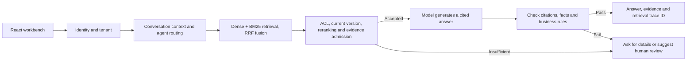
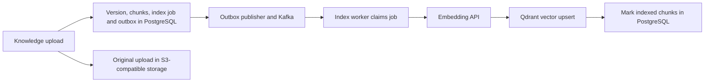

# Architecture

[Home](../README.md) · [简体中文](architecture.zh-CN.md) · [Retrieval benchmark](benchmark.md)

## Answering a knowledge question

The enterprise workbench calls the Spring Boot API through Nginx. The API resolves the tenant and operator from the bearer token, then uses conversation context and intent to select a support agent. The diagram follows a question that requires company-policy evidence.

- **Retrieval.** Qdrant returns candidates for the tenant. PostgreSQL is consulted for document access and current version before evidence can reach the model.
- **Answer guard.** [`EnterpriseChatService`](../src/main/java/com/supportforge/grounding/EnterpriseChatService.java) supplies admitted evidence IDs to the model and checks whether the response actually cites them. It also checks business constraints such as retaining a required manual review.
- **Operational record.** The chat response includes the selected agent, emitted sources and the verification outcome. The retrieval trace records the evidence decision. Micrometer, Prometheus and OpenTelemetry support runtime diagnosis.

## Indexing a knowledge document

The [index worker](../src/main/java/com/supportforge/indexing/KnowledgeIndexingWorker.java) checks its job claim and records completion in PostgreSQL. Retrieval uses the current document version, so old candidates left in the index cannot become answer evidence.

| Component | Responsibility |
| --- | --- |
| PostgreSQL and Flyway | Document versions, access grants, index jobs, conversation memory, feedback and audit |
| Qdrant | Candidate retrieval over indexed knowledge chunks |
| Kafka and the transactional outbox | Delivery of indexing jobs |
| S3-compatible object storage | Original uploaded files |
| Caffeine and Valkey | Cache for user facts |
| Prometheus and Jaeger | Metrics and traces |

## Runtime profiles

The local profile uses mock providers and local stores for development. The enterprise profile uses external providers for chat, embeddings and reranking and enables tenant-scoped access. The local LAN tokens are intended for demos. For a production deployment, use a trusted identity provider, TLS and managed secrets.

A response with `escalated=true` is a recommendation for a human to review the case. The workbench displays that recommendation alongside the answer or verification result.
