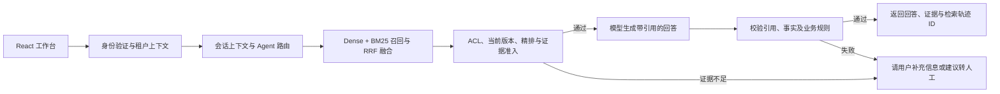
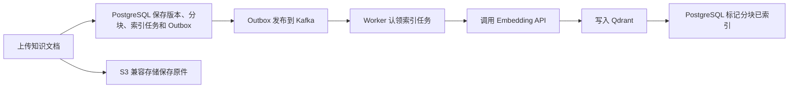

# 系统架构

[项目首页](../README.zh-CN.md) · [English](architecture.md) · [检索评测](benchmark.zh-CN.md)

## 一次知识问答

企业工作台通过 Nginx 访问 Spring Boot API。后端根据令牌确认租户与操作人，再结合会话上下文和意图分配 Agent。下图以需要企业政策证据的问题为例。

- **检索。** Qdrant 给出候选。候选成为证据前，系统以 PostgreSQL 中的文档访问权限与当前版本为准。
- **回答校验。** [`EnterpriseChatService`](../src/main/java/com/supportforge/grounding/EnterpriseChatService.java) 把准入证据编号提供给模型，并检查回答是否实际引用了这些证据。业务规则要求人工审核时，校验还会检查回答是否保留了这一要求。
- **运行记录。** 聊天结果会返回所选 Agent、实际引用和复核状态，检索轨迹记录证据准入决策。Micrometer、Prometheus 和 OpenTelemetry 提供排查所需的指标与追踪。

## 一篇知识文档如何入库

[索引 Worker](../src/main/java/com/supportforge/indexing/KnowledgeIndexingWorker.java) 检查认领状态，并在 PostgreSQL 记录索引结果。检索按当前文档版本核验，因此索引中残留的旧候选不会成为回答证据。

| 组件 | 职责 |
| --- | --- |
| PostgreSQL / Flyway | 文档版本、访问授权、索引任务、会话记忆、反馈和审计 |
| Qdrant | 从已索引的知识分块中召回候选 |
| Kafka / Transactional Outbox | 投递索引任务 |
| S3 兼容对象存储 | 保存上传原件 |
| Caffeine / Valkey | 用户事实缓存 |
| Prometheus / Jaeger | 指标与链路追踪 |

## 运行模式

默认模式使用 Mock 供应商和本地存储。企业模式通过外部 API 接入对话模型、Embedding 和 Reranker，并按租户限制访问。本地 LAN 令牌用于演示，生产部署应接入可信身份系统、TLS 和密钥管理。

`escalated=true` 表示系统建议人工复核，工作台会把该建议与回答或校验结果一起展示。
